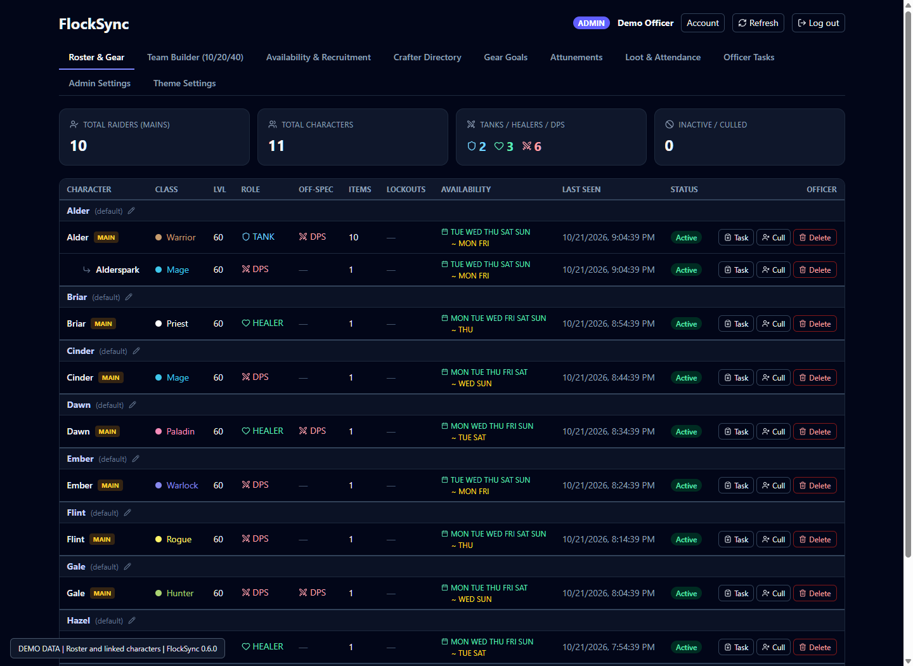
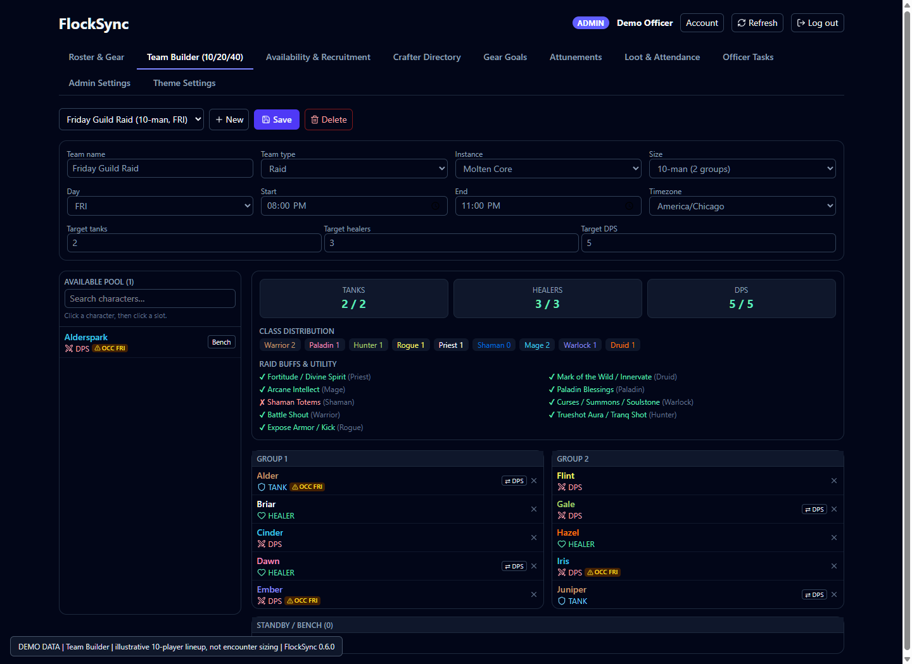
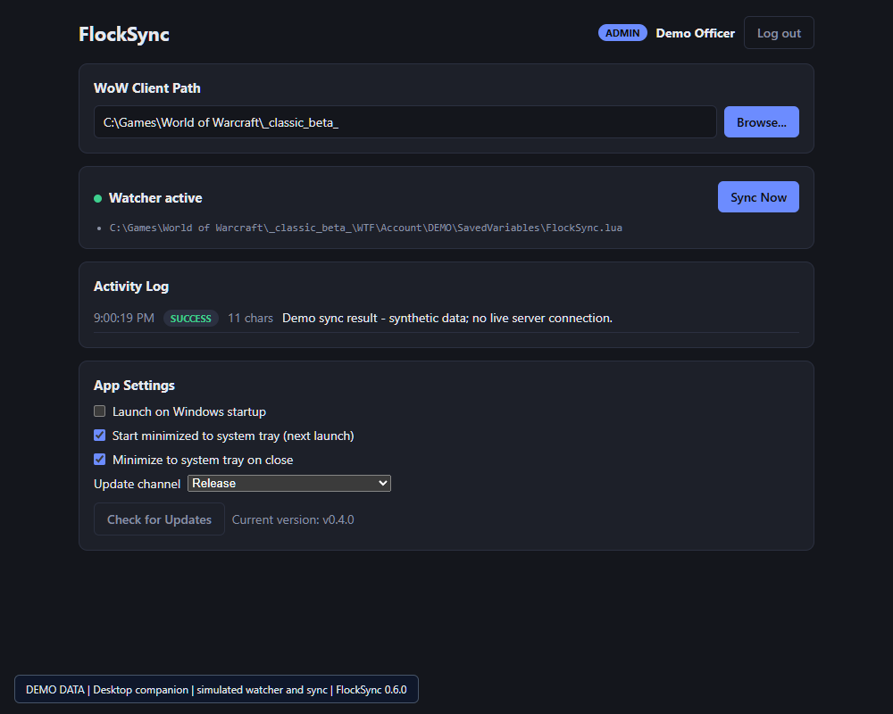

# FlockSync

**Your guild's characters, raid plans, and crafting knowledge in one place.**

FlockSync connects a **WoW Forever addon**, a **Windows desktop sync companion**,
and a **guild-hosted web dashboard**. Members share their character data in game;
officers collect it and bring roster management and planning onto the web.
Built by **GearDuckDev** for **WoW Forever, Interface 16001**.

**Release-channel, still pre-1.0.** Features continue to evolve. This project does
not claim official server endorsement or guarantee that its use is ban-safe.
Confirm your server's rules before using the addon and desktop bridge.

[Downloads](https://github.com/GearDuckDev/FlockSync/releases) |
[Server setup](./DEPLOYMENT.md) | [Release notes](./RELEASE-NOTES.md) |
[Screenshot gallery](./docs/SCREENSHOTS.md)

## See it in action

These are real application screens with **fictional demonstration data**, not
live guild information. Desktop watcher/sync responses are simulated.
Web/desktop screenshots are not in-game addon screenshots.

### Web: roster and linked characters


### Web: plan the lineup


### Desktop: save, sync, and stay in the tray


The [full gallery](./docs/SCREENSHOTS.md) also covers gear, crafters, goals,
attunements, attendance, tasks, administration, and themes. Genuine in-game
captures are still pending; the gallery includes a shot checklist.

## Which download do I need?

| You are... | Install |
| --- | --- |
| A guild member | **FlockSync** from CurseForge or `FlockSync-Raider-Only.zip` |
| An officer/admin collecting data | **FlockSync + AppHelper** from `FlockSync-Addon-Bundle.zip`, plus one Windows desktop download |
| Hosting the guild server | `FlockSync_Pi_Deploy.zip`; follow [DEPLOYMENT.md](./DEPLOYMENT.md) |

Regular members do **not** need AppHelper, the desktop app, or a website account
to broadcast their character data. The guild needs an active collector and a
configured server for dashboard and server-returned information.

There is **one main addon**, not separate member/officer editions. CurseForge
updates the main addon only. Officers using CurseForge can extract just
`FlockSync_AppHelper` from the GitHub bundle alongside their managed installation.

## What you can do

### In game
- Complete a first-time walkthrough to choose your role, main, and feature toggles.
- Share gear, roles/off-spec, availability, lockouts, professions, goals, and attunements.
- View returned raid assignments and standby placement.
- Search guild crafters, see relevant crafting/goal tooltip lines, and find matching goals.
- Use officer invite tools, subject to WoW's normal group/leadership restrictions.
- Open Features with `/fs`; open Options with `/fs options` or minimap right-click.

Shared views depend on the last received snapshot, not a continuous website
connection. Profession recipes require opening each profession window in game.
Item search is a bounded local cache, not a complete game-item database.

### On the web
| Tab | Purpose |
| --- | --- |
| Roster & Gear | Mains/alts, aliases, gear inspection, roles, availability, and officer cull/restore/delete controls |
| Team Builder | Raid, dungeon, and PvP lineups; groups, bench, role targets, class/utility coverage, and same-player conflict checks |
| Availability & Recruitment | Weekly availability by role and lineup recruitment gaps |
| Crafter Directory | Search synced recipes, professions, and item IDs |
| Gear Goals | Find players chasing the same item or sharing run-note keywords |
| Attunements | Group by the main's step; expand initially collapsed alts to see their individual progress |
| Loot & Attendance | Recorded loot and 30/60/90-day attendance, counting mains and alts as one player |
| Officer Tasks | Character-linked task board for officers/admins |
| Admin Settings | Account roles and server update notices |
| Theme Settings | Optional backgrounds, custom uploads, admin defaults, and personal overrides |

**Themes start at None.** Bundled options are Alliance, Horde, and World of
Warcraft; the example guild image is not included. PNG/JPEG uploads accept up
to 5 MB, resize to at most 1024 pixels per side, and must fit the encoded storage
limit. Opacity is adjustable from 0% to 40%. Defaults and personal overrides are
stored in SQLite; **Use server default** removes a personal override. Server
default changes appear on browser focus or within a minute.

### On Windows
- Sign in to your guild's server and select the WoW client folder.
- Watch FlockSync SavedVariables and sync when WoW writes them.
- Keep syncing in the tray after closing the window.
- Independently choose Windows startup, start-minimized, and close-to-tray behavior.
- Check Release/Beta/Alpha updates and open the matching GitHub download.

Start-minimized defaults **off** and applies next launch. If the tray cannot be
created, the window opens instead. An explicit `--hidden` launch argument still
hides it; old Windows startup entries are rewritten without that argument.

## Member setup
1. Exit WoW, install the main addon, and confirm
   `Interface\AddOns\FlockSync\FlockSync.toc` exists without an extra nested folder.
2. Log in and finish the walkthrough. Nothing is scanned/broadcast before Finish.
3. Set your main, role, availability, and optional goals. Open profession windows
   to capture recipes, and keep the addon enabled while playing.
4. Use `/fs` for shared information. Your guild's collector must receive your
   broadcasts before uploading them; your own `/reload` does not save another
   player's collected copy.

## Officer / collector setup
1. Install both addon folders from the officer bundle. Preserve SavedVariables
   when upgrading. Use either the Windows installer or portable app, not both.
2. Ask your guild administrator for the **full server URL** and an **OFFICER or
   ADMIN** website account. Enter the URL without `/api`. Self-registration
   creates a MEMBER account; an administrator must promote it before collection.
3. Select the WoW client folder containing `Interface` and `WTF`, not AddOns.
4. Complete addon setup and play on a character in the intended guild. Native
   guild permissions can recognize a collector. Website-authorized collection
   additionally requires a successful sync and loading the returned guild grant.
5. Log out to save collected data, wait for desktop success, then log back in to
   load the helper return. `/reload` also saves/loads, but logout -> sync -> login
   is the clearest return-file sequence.
6. Refresh the dashboard. Same-account low-ranked alts can collect in the
   authorized guild and realm; other guilds/realms/guildless characters cannot.
   Each WoW account folder needs its own sync. A guildless sync clears the grant.

Collectors only catch broadcasts while logged in; the app cannot retrieve
messages sent while offline. AppHelper installation and local test overrides
do not replace server authentication or grant website permissions.

The GearDuckDev-hosted dashboard is
[flocksync.gearduckdev.com](https://flocksync.gearduckdev.com). Other guilds should
use the server address supplied by their own administrator.

## How synchronization works

```text
Member addon --guild addon messages--> Collector addon
                                         |
                                  logout or /reload
                                         v
                                  SavedVariables
                                         |
                                  Windows desktop
                                         v
                                  API + SQLite <--> Web
                                         |
                                  AppHelper return file
                                         v
                                  next login /reload
```

Only FlockSync SavedVariables are parsed. Character records use epoch-based
newer-data conflict resolution; last-seen reflects scans, not re-upload time.
Guild messages are chunked/throttled, and snapshot data can be relayed to members
without a desktop app. Cached in-game snapshots are informational, not an
authorization source. WoW does not fetch GitHub or your API directly.

## Commands
| Command | Opens / does |
| --- | --- |
| `/fs` | Features window |
| `/fs options` (`config`, `setup`) | Options |
| `/fs role` (`main`) | Role & Main |
| `/fs raid` (`schedule`) | Raid Schedule |
| `/fs craft` | Crafter Search |
| `/fs prof` | Professions & Goals |
| `/fs minimap` | Toggle minimap icon |
| `/fs help` | Command help |
| `/fs debug officer` / `/fs debug officer off` | Session-only local test override; not normal setup |

Minimap left-click opens Features; right-click opens Options; drag to reposition.
Display toggles hide UI, not character-data sharing after onboarding.

## Hosting and development

Production: follow [DEPLOYMENT.md](./DEPLOYMENT.md) for Docker, Cloudflare,
SQLite backups, and restores. Preserve `.env` and `data` during upgrades. Run
`sh deploy/update-server.sh` to verify a backup before rebuilding/restarting.
Never use `docker compose down -v` as an upgrade step. Deploy API/web together.

Development requires Node.js 20+, pnpm, and Windows for desktop/addon linking.
Copy `apps/api/.env.example` to `apps/api/.env` and configure its required
database path, JWT secret, and initial-admin credentials before starting.

```powershell
pnpm install
pnpm dev:api
# Separate terminals:
pnpm dev:web
pnpm dev:desktop
```

The API applies migrations at startup. For local addon edits, run
`.\scripts\link-addons.ps1` (optional `-WowAddonsPath` overrides the default).
Web API configuration uses `VITE_API_BASE_URL` (production `/api`, development
`http://localhost:3001/api`); legacy `VITE_API_URL` is also supported.
`VITE_WOWHEAD_PATH` defaults to `forever`.

| Path | Responsibility |
| --- | --- |
| `packages/shared-types` | Shared TypeScript/Zod contracts |
| `apps/api` | Fastify, Drizzle, SQLite WAL, JWT authentication |
| `apps/web` | React, Vite, Tailwind dashboard |
| `apps/desktop` | Electron sync companion |
| `apps/addon` | Lua 5.1 main addon and AppHelper |

Validate with `pnpm run typecheck` and `pnpm build`. Package with
`.\scripts\package-release.ps1 -ReleaseVersion 0.6.0`; see
[RELEASES.md](./RELEASES.md) for tests, all six downloads, and publishing rules.
Update checks compare component versions, not the overall release tag.

## Permissions, privacy, and troubleshooting

- Website roles are MEMBER, OFFICER, and ADMIN. Accounts are rechecked on each
  authenticated request. Server sync and management writes require authorization.
- Admin Settings manages accounts; Account changes your own username. The root
  admin has additional protections. In-game overrides are not API access controls.
- Secrets come from environment configuration. Keep databases, credentials,
  SavedVariables, and real account information out of public screenshots.
- Missing data? Finish onboarding, let a collector receive updates, save the
  collector's file, check desktop sync, then Refresh. Open profession windows
  before expecting recipes. Characters idle for 30+ days can become inactive;
  manual culls remain until restored.
- Attunement quest mappings should be verified against the Forever client.
- This is a public-source, **proprietary** project, not an open-source license.
  See [LICENSE](./LICENSE) for use, hosting, and redistribution terms.
