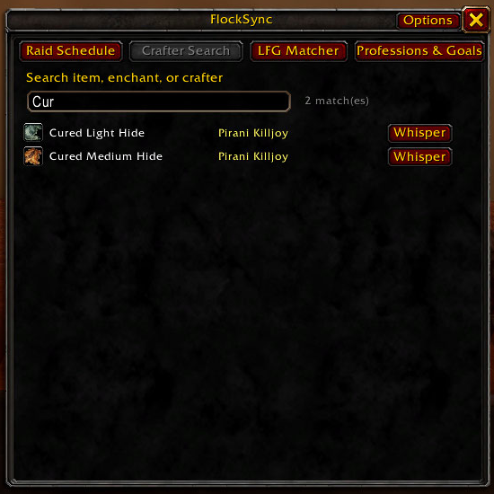
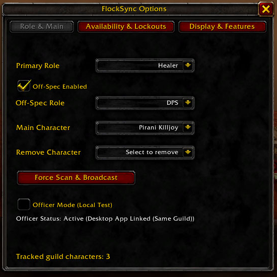
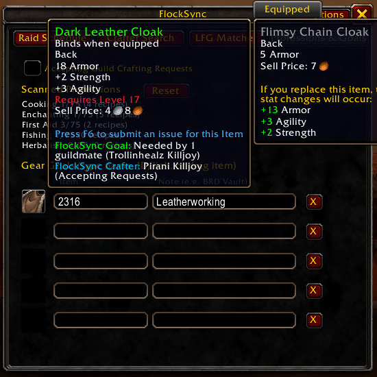
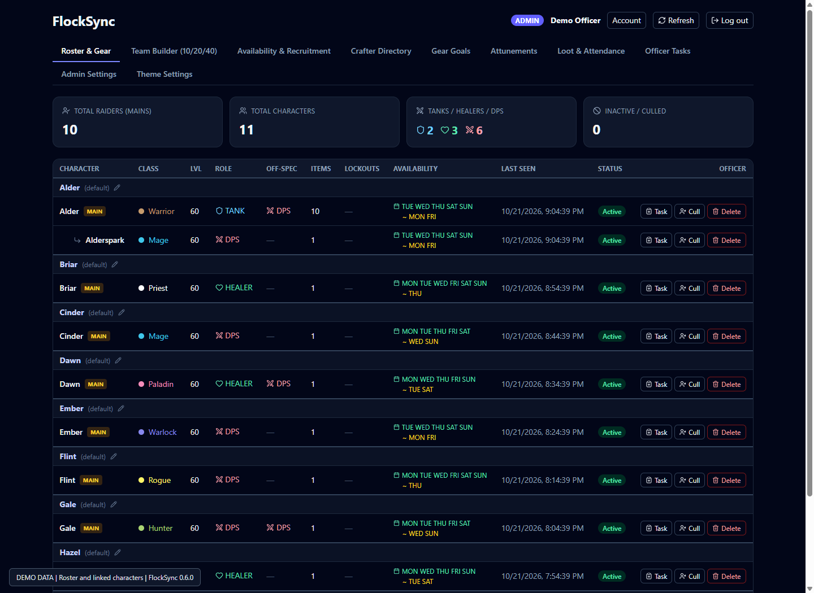
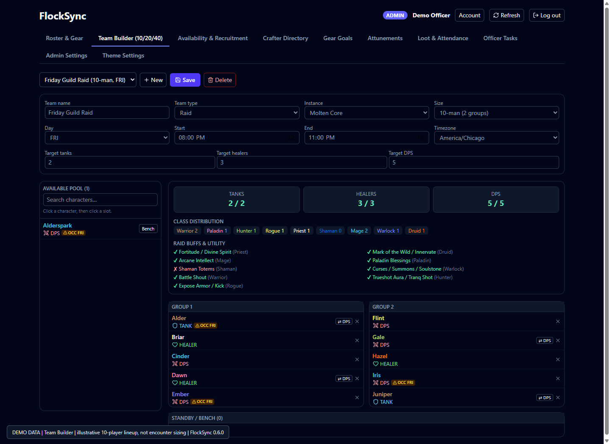
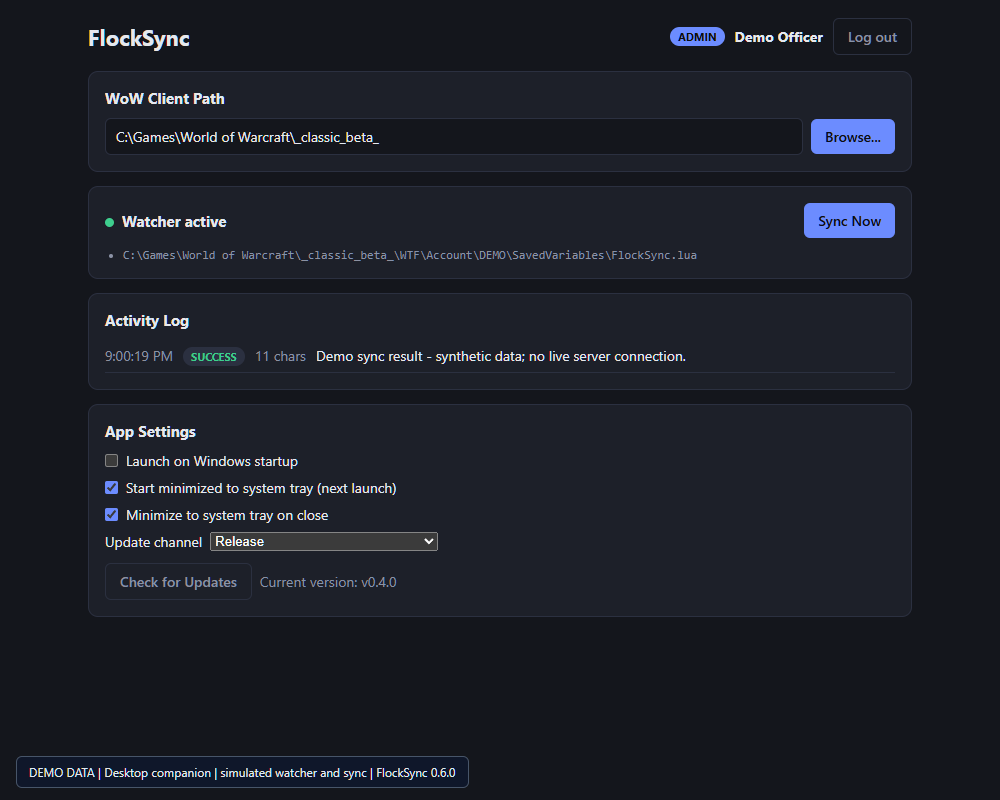

# FlockSync

**Your guild's characters, raid plans, and crafting knowledge in one place.**

FlockSync connects a **WoW Forever addon**, a **Windows desktop sync companion**,
and a **guild-hosted web dashboard**. Members share their character data in game;
officers collect it and bring roster management and planning onto the web.
Built by **GearDuckDev** for **WoW Forever, Interface 16001**.

**FlockSync 1.0.0 is the feature-complete release of the guild-management
toolkit.** The addon, Windows sync companion, and self-hosted dashboard bring
character sharing, guild planning, crafting, and shared guild tools together.
The project remains maintained; see the release notes for changes. FlockSync
does not claim official server endorsement or guarantee that its use is
ban-safe. Confirm your server's rules before using the addon and desktop bridge.

[Downloads](https://github.com/GearDuckDev/FlockSync/releases) |
[Server setup](./DEPLOYMENT.md) | [Release notes](./RELEASE-NOTES.md) |
[Screenshot gallery](./docs/SCREENSHOTS.md)

**Hosting your own server? [Server operations quick reference](./SERVER-OPERATIONS.md)**
covers status checks, safe stop/start, and backup-aware updates.

## See it in action

The addon images below are developer-supplied in-game captures. Web and desktop
images use **fictional demonstration data**; desktop watcher/sync responses are
simulated. The two sets are labeled separately.

### Addon: find a guild crafter


### Addon: roles, main character, and collection


### Addon: useful item tooltips


### Web: roster and characters


### Web: plan the lineup


### Desktop: save, sync, and stay in the tray


The [full gallery](./docs/SCREENSHOTS.md) also covers gear, crafters, goals,
attunements, attendance, tasks, administration, and themes, plus all eight
in-game captures and CurseForge image-hosting instructions.

## Which download do I need?

| You are... | Install |
| --- | --- |
| A guild member | **FlockSync** from CurseForge or `FlockSync-Raider-Only.zip` |
| An officer/admin collecting data | **FlockSync + AppHelper** from `FlockSync-Addon-Bundle.zip`, plus one Windows desktop download |
| Hosting the guild server | `FlockSync_Remote_Server_Deploy.zip`; follow [DEPLOYMENT.md](./DEPLOYMENT.md) |

Regular members do **not** need AppHelper, the desktop app, or a website account
to broadcast their character data. The guild needs an active collector and a
configured server for dashboard and server-returned information.

There is **one main addon**, not separate member/officer editions. CurseForge
updates the main addon only. Officers using CurseForge can extract just
`FlockSync_AppHelper` from the GitHub bundle alongside their managed installation.

## What you can do

### In game
- Complete a first-time walkthrough to choose your role, main, and feature toggles.
- Share gear, roles/off-spec, availability, lockouts, professions, goals, and attunements.
- View returned raid assignments and standby placement.
- Search guild crafters, see relevant crafting/goal tooltip lines, and find matching goals.
- Use officer invite tools, subject to WoW's normal group/leadership restrictions.
- Open Features with `/fs`; open Options with `/fs options` or minimap right-click.

Shared views depend on the last received snapshot, not a continuous website
connection. Profession recipes require opening each profession window in game.
Item search is a bounded local cache, not a complete game-item database.

#### Kill List: guild sharing and setup

The six-page first-time walkthrough now explains crafting orders, group-play
availability and the optional Kill List. **Accepting Orders** (the
**Accepting Guild Crafting Requests** checkbox in `/fs prof`) defaults on for
characters without a saved choice; existing opt-outs stay off. Open each
profession window to share its recipes. This is a crafting-availability flag,
not an automated order/trade system.

The availability page explains account-wide timezone, days and play hours for
raids, dungeons and PvP. By default, Finish opens the existing availability
editor; uncheck that option to skip it. Use `/fs availability` later.
Unset availability defaults are not published as your schedule.

Enable Kill List per character with `/fs killoptions`, then use `/fs kill`,
`/fs kill add [player name]`, or the enemy-player portrait action. Without a
typed name the add command uses your current enemy-player target when readable.
Enter the full **First Last** player name. The current realm is automatic and
is not shown as a separate field; saved realm identity remains internal.

- Shared and Personal start unchecked; choose either or both to enable OK.
  Selecting **Guild Shared** sends the target and note to online guildmates
  when you save; no separate Publish step for new additions. Existing legacy
  drafts stay private until you explicitly Publish them.
  If current guild-roster identity is unavailable or the sending queue is
  full, saving reports an error and leaves the editor open; neither destination
  is added if both were selected. Retry when the roster/queue is ready.
  Personal entries are character-local and excluded from messages and uploads.
- Reasons allow 500 Unicode characters. The list shows at most 80 characters
  including truncation; notes do not appear in tooltips.
- Personal reasons are editable. Any current online guild member can add,
  edit, remove, and publish shared targets in game. Removal asks for confirmation
  and affects only that list. Same-second changes require retry.
- Disabling Personal keeps entries but ignores personal-only targets; disabling
  Kill List preserves entries and hides its tab; shared sync continues.
- Login/finishing setup requests catch-up. `/fs kill sync` retries (once per
  minute). Guild-rank officers can relay the complete verified live list;
  members can reannounce only their own unedited additions/removals. At least
  one online client retaining an eligible copy is needed for immediate recovery.
  Published shared entries now persist through officer Desktop sync; personal
  entries and drafts never upload. Server recovery requires the collector's
  logout -> successful Desktop sync -> login sequence, then automatic guild relay.
- Removal markers persist so old copies cannot restore removed entries.
  Equal-time conflicts are rejected; an officer must retry the intended change
  in a later second. Local drafts conflicting with a guild entry are preserved:
  remove the unwanted draft, then request sync to receive the guild record.
- Messages are chunked/throttled on a separate guild prefix. Sending can take
  time for long notes/lists; stay online until delivery. Queue-full errors leave
  the local change unsent and ask for retry. Catch-up failure is reported.
- The authenticated API lets any signed-in user add shared targets, edit their
  reasons, or remove them. Use the website **Kill List** tab to search existing
  entries and make changes; collector sync returns website changes to the game.
  Refresh after conflicts before retrying.
- Readable enemy players are detected on target, mouseover, focus and nameplate
  events, not periodic scans. Popup and sound default on after opt-in and have
  separate settings, with a 60-second cooldown per target. Remote reports
  update last-seen data but never trigger local nearby alerts. Nothing can
  detect players the client does not expose.
- Optional nameplate skulls are local overlays, default off. They are not raid
  marks and never target players or invoke protected marking APIs.
- Each entry shows its latest reported zone/time (`MM-DD-YYYY HH:MM`, local
  timezone) and a History button. Hide history independently from reporting.
  Turn off **Share sightings and battles** to keep new reports character-local;
  turning it back on does not publish that private interval's history.
  Personal-only observations/history stay character-local; shared drafts do
  not generate shared reports.
- Battle attribution uses readable `PARTY_KILL` participant GUIDs or your own
  fresh death recap with explicit fatal damage and readable identities.
  Unreadable/secret data, nonfatal hits, stale recaps, unknown enemies and
  ambiguous killers are skipped, never guessed. Pet kills without a readable
  party/guild player identity and deaths without sufficient evidence are not
  attributed. Client-specific event/recap support requires game acceptance.
- Published sightings and verified battles travel through the same bounded
  guild transport and collector Desktop/server/helper path. Login catch-up
  starts automatically, newest observations first after target records; large
  histories may take substantial online time. A native guild-rank officer can
  recover reports retained by other clients or the server. These are
  roster-attested client reports, not a server-verified combat log.
- Battle history retains 90 days and at most 5,000 guild events; each target
  retains one latest sighting. Duplicate battle reports within five seconds
  from the same killer/victim are combined. Removing/recreating a target does
  not attach its old history to the new creation. Permanent target removal
  markers are not subject to history retention.

**Release behavior:** friendly-player portrait additions are disabled. Target-based
`/fs kill add` requires a readable enemy player; NPCs and unreadable data are
excluded. Typed names remain supported without proving hostility. Existing saved
entries are preserved, including previous test entries; remove unwanted test
entries through the UI. Friendly players do not trigger sightings, alerts or skulls.

Existing users are not forced through setup again. To revisit it, use
**Reset First-Time Walkthrough** in Options > Display & Features; scanning and
broadcasting pause until Finish. Existing saved choices are preserved.

### On the web
| Tab | Purpose |
| --- | --- |
| Roster & Gear | Mains/alts, aliases, gear inspection, roles, availability, and officer cull/restore/delete controls |
| Team Builder | Raid, dungeon, and PvP lineups; groups, bench, role targets, class/utility coverage, and same-player conflict checks |
| Availability & Recruitment | Weekly availability by role and lineup recruitment gaps |
| Crafter Directory | Search synced recipes, professions, and item IDs |
| Gear Goals | Find players chasing the same item or sharing run-note keywords |
| Attunements | Group by the main's step; expand initially collapsed alts to see their individual progress |
| Loot & Attendance | Recorded loot and 30/60/90-day attendance, counting mains and alts as one player |
| Officer Tasks | Character-linked task board for officers/admins |
| Kill List | Signed-in users add targets, edit reasons, and remove shared entries |
| Admin Settings | Account roles, database backup/restore, persistent backup folders, guild-data wipe, and server update notices |
| Theme Settings | Custom UI/page colors, optional backgrounds, custom uploads, admin defaults, and personal overrides |

The dashboard header shows the guild name from the latest timestamped collector
sync. Guild identity is stored in SQLite and included in subsequent backups:
restore brings back that snapshot's guild name, while wipe clears it until a new
collector sync. Older backups have no guild identity; sync a collector and refresh
the dashboard to populate it.

### Existing character ownership links

The Character Links dashboard controls have been removed. Existing verified
ownership records remain stored and continue to govern member-filtered group
views, but the web app no longer provides controls to assign or revoke them.
Kill List permissions no longer depend on character ownership.

### Member group views

Website members see only Team Builder groups and recruitment callouts containing
One of their verified linked characters, either assigned or on the bench.
All linked characters count, across raid, dungeon and PvP groups. Main/alt
labels alone do not grant access without an existing verified ownership link.
Unlinked users see no groups; linked users without memberships see an explicit
empty state, not an unrelated or previously selected lineup.
Officers/admins retain all groups and management controls.

Use the dashboard **Refresh** button after ownership/membership changes.
Data also refreshes on browser focus and every minute; stale selected member
lineups disappear when membership is revoked. Loading/errors hide member groups
until verified links are available. This is a **display filter, not private
delivery**: the API and in-game snapshots may still deliver all guild groups,
as designed. Weekly guild availability, crafting and gear-goal views remain
guild-wide; they are not restricted by group membership.

In-game Raid Schedule uses the same verified owner keys: membership of any
linked character, including standby, makes its raid visible. Unlinked members
see linking/sync instructions; current guild-roster officers see all raids.
The existing in-game schedule snapshot contains RAID teams only; website
dungeon/PvP groups remain available on the website, not newly added here.
Changes reach the game after logout -> successful Desktop sync -> login and
officer relay, not immediately when changing a website link.

The existing in-game officer snapshot relay delivers crafting recipes and
gear-goal matches to ordinary members without Desktop/AppHelper or collector
permissions, including tooltip information. Login requests catch-up automatically;
an online collector with a desktop-sourced snapshot is needed. Simulated Lua
clients verify relay, late joins, caching and guild isolation; the maintainer
also accepted live-client crafting/goal relay before the persistence changes.
The new persistence/ownership return still needs its own live-client acceptance.

### Shared kill-list persistence preview

Use matching candidate API, Desktop and main addon builds. Desktop uploads only
published records from the collector's guild/realm and returns durable shared
records, including removal markers. Keep WoW logged out while Desktop writes
AppHelper; log back in afterward. The ordinary member needs neither Desktop nor
AppHelper. New Guild Shared additions send automatically on save; subsequent delivery/
login catch-up is automatic, with `/fs kill sync` only an optional recovery tool.
Native guild-roster officers must be online to redistribute server-returned
changes. A website-only collector can upload/load its own helper but cannot
assert roster-officer authority to peers.

The website **Kill List** tab searches names, realms, authors and reasons.
It never displays personal records or private drafts. Any signed-in user may
add targets, edit reasons (up to 500 Unicode characters), or remove shared
entries; shared removals require confirmation. Collector sync returns web
changes to the game. The page refreshes on focus, every minute and with
**Refresh Kill List**. Concurrent changes fail explicitly and keep the draft;
refresh, then cancel/reopen the editor before retrying if the entry changed.

Upserts require strictly newer server-second timestamps. Equal-time conflicts
fail explicitly; refresh/retry the intended change later. A stale copy or an
old creation edited after deletion cannot restore a target: re-add in game.
Original author/creation identity is retained by note edits. The server trusts
authenticated collectors to attest guild messages; this is not game-account
cryptographic verification. Do not treat website links as in-game officer grants.

SQLite backups include shared records/removals. Restore advances their sync
timestamps past the restore reset fence while retaining author/creation
identity; guild-data wipe clears them. Normal sync never deletes a server entry
merely because it was absent from an upload. Lists are validated/bounded to
5,000 records per upload/return; larger sets need a future paged transport.

### Database administration

Admin Settings supports working **backup, restore, and guild-data wipe** controls.
The operator successfully tested restore and wipe in a smaller private
environment; this is user-reported validation, not certification of every
deployment or live WoW scenario.

- **Create backup:** save a verified online SQLite snapshot to the configured
  backup storage destination, optionally downloading a second copy to your device.
- **Restore backup:** choose the newest or another server snapshot (with local
  date/time displayed), or upload a custom backup up to 128 MB. A pre-restore
  safety backup is saved first. Restoring replaces accounts and application
  records, so the restored credentials may be required.
- **Wipe guild data:** type the confirmation, save a `final` backup, then clear
  guild records and themes while retaining accounts and the backup-folder setting.
  The reset marker reaches updated addons through collector/AppHelper sync and
  guild snapshots; the API rejects pre-reset data.
- **Backup folder:** browse/create subfolders on the server's mounted backup storage volume.
  The setting persists across updates and also directs scheduled/pre-update
  backups. This is not a Windows PC folder picker.

Keep independent backups and preserve `.env` and `data` during updates. Follow
[DEPLOYMENT.md](./DEPLOYMENT.md) for backup storage permissions, restore safety, and the
logout -> desktop sync -> login sequence after a reset.

**Themes start at None.** Bundled options are Alliance, Horde, and World of
Warcraft; the example guild image is not included. PNG/JPEG uploads accept up
to 5 MB, resize to at most 1024 pixels per side, and must fit the encoded storage
limit. Opacity is adjustable from 0% to 40%. Defaults and personal overrides are
stored in SQLite; **Use server default** removes a personal override. Server
default changes appear on browser focus or within a minute.
UI and page background colors are linked by default. Enable **Separate UI and
background colors** to choose a different color behind the emblem. The live
preview shows panel/control shades and the page background before saving.
Neutral text adjusts to light or dark surfaces; action and status colors are
preserved. Existing saved themes keep their original colors until customized.

### On Windows
- Sign in to your guild's server and select the WoW client folder.
- Fresh installs default to `C:\Program Files (x86)\World of Warcraft\_forever_`.
  You can change this location; saved custom or older client paths remain unchanged.
- Watch FlockSync SavedVariables and sync when WoW writes them.
- Keep syncing in the tray after closing the window.
- Independently choose Windows startup, start-minimized, and close-to-tray behavior.
- Check Release/Beta/Alpha updates and open the matching GitHub download.

Start-minimized defaults **off** and applies next launch. If the tray cannot be
created, the window opens instead. An explicit `--hidden` launch argument still
hides it; old Windows startup entries are rewritten without that argument.

## Member setup
1. Exit WoW, install the main addon, and confirm
   `Interface\AddOns\FlockSync\FlockSync.toc` exists without an extra nested folder.
2. Log in and finish the walkthrough. Nothing is scanned/broadcast before Finish.
3. Set your main, role, availability, and optional goals. Open profession windows
   to capture recipes, and keep the addon enabled while playing.
4. Use `/fs` for shared information. Your guild's collector must receive your
   broadcasts before uploading them; your own `/reload` does not save another
   player's collected copy.

## Officer / collector setup
1. Install both addon folders from the officer bundle. Preserve SavedVariables
   when upgrading. Use either the Windows installer or portable app, not both.
2. Ask your guild administrator for the **full server URL** and an **OFFICER or
   ADMIN** website account. Enter the URL without `/api`. Self-registration
   creates a MEMBER account; an administrator must promote it before collection.
3. Select the WoW client folder containing `Interface` and `WTF`, not AddOns.
4. Complete addon setup and play on a character in the intended guild. Native
   guild permissions can recognize a collector. Website-authorized collection
   additionally requires a successful sync and loading the returned guild grant.
5. Log out to save collected data, wait for desktop success, then log back in to
   load the helper return. `/reload` also saves/loads, but logout -> sync -> login
   is the clearest return-file sequence.
6. Refresh the dashboard. Same-account low-ranked alts can collect in the
   authorized guild and realm; other guilds/realms/guildless characters cannot.
   Each WoW account folder needs its own sync. A guildless sync clears the grant.

Collectors only catch broadcasts while logged in; the app cannot retrieve
messages sent while offline. AppHelper installation and local test overrides
do not replace server authentication or grant website permissions.

Use the server address supplied by your own guild administrator. Fresh desktop
installs have no server URL configured; they do not connect to a maintainer's
instance. Each operator supplies their own domain, tunnel, credentials, and
backup location.

## How synchronization works

```text
Member addon --guild addon messages--> Collector addon
                                         |
                                  logout or /reload
                                         v
                                  SavedVariables
                                         |
                                  Windows desktop
                                         v
                                  API + SQLite <--> Web
                                         |
                                  AppHelper return file
                                         v
                                  next login /reload
```

Only FlockSync SavedVariables are parsed. Character records use epoch-based
newer-data conflict resolution; last-seen reflects scans, not re-upload time.
Guild messages are chunked/throttled, and snapshot data can be relayed to members
without a desktop app. Cached in-game snapshots are informational, not an
authorization source. WoW does not fetch GitHub or your API directly.

## Commands
| Command | Opens / does |
| --- | --- |
| `/fs` | Features window |
| `/fs options` (`config`, `setup`) | Options |
| `/fs role` (`main`) | Role & Main |
| `/fs raid` (`schedule`) | Raid Schedule |
| `/fs craft` | Crafter Search |
| `/fs prof` | Professions & Goals |
| `/fs minimap` | Toggle minimap icon |
| `/fs help` | Command help |
| `/fs debug officer` / `/fs debug officer off` | Session-only local test override; not normal setup |

Minimap left-click opens Features; right-click opens Options; drag to reposition.
Display toggles hide UI, not character-data sharing after onboarding.

## Hosting and development

Production: follow [DEPLOYMENT.md](./DEPLOYMENT.md) for Docker, Cloudflare,
SQLite backups, and restores. Preserve `.env` and `data` during upgrades. Run
`sh deploy/update-server.sh` to verify a backup before rebuilding/restarting.
Never use `docker compose down -v` as an upgrade step. Deploy API/web together.

Development requires Node.js 20+, pnpm, and Windows for desktop/addon linking.
Copy `apps/api/.env.example` to `apps/api/.env` and configure its required
database path, JWT secret, and initial-admin credentials before starting.

```powershell
pnpm install
pnpm dev:api
# Separate terminals:
pnpm dev:web
pnpm dev:desktop
```

The API applies migrations at startup. For local addon edits, run
`.\scripts\link-addons.ps1` (optional `-WowAddonsPath` overrides the default).
Web API configuration uses `VITE_API_BASE_URL` (production `/api`, development
`http://localhost:3001/api`); legacy `VITE_API_URL` is also supported.
`VITE_WOWHEAD_PATH` defaults to `forever`.

| Path | Responsibility |
| --- | --- |
| `packages/shared-types` | Shared TypeScript/Zod contracts |
| `apps/api` | Fastify, Drizzle, SQLite WAL, JWT authentication |
| `apps/web` | React, Vite, Tailwind dashboard |
| `apps/desktop` | Electron sync companion |
| `apps/addon` | Lua 5.1 main addon and AppHelper |

Validate with `pnpm run typecheck` and `pnpm build`. Package with
`.\scripts\package-release.ps1 -ReleaseVersion <new-version>`; see
[RELEASES.md](./RELEASES.md) for tests, all six downloads, and publishing rules.
Update checks compare component versions, not the overall release tag.

## Permissions, privacy, and troubleshooting

- Website roles are MEMBER, OFFICER, and ADMIN. Accounts are rechecked on each
  authenticated request. Server sync and management writes require authorization.
- Admin Settings manages accounts; Account changes your own username. The root
  admin has additional protections. In-game overrides are not API access controls.
- Secrets come from environment configuration. Keep databases, credentials,
  SavedVariables, and real account information out of public screenshots.
- Missing data? Finish onboarding, let a collector receive updates, save the
  collector's file, check desktop sync, then Refresh. Open profession windows
  before expecting recipes. Characters idle for 30+ days can become inactive;
  manual culls remain until restored.
- Attunement quest mappings should be verified against the Forever client.
- This is a public-source, **proprietary** project, not an open-source license.
  See [LICENSE](./LICENSE) for use, hosting, and redistribution terms.
